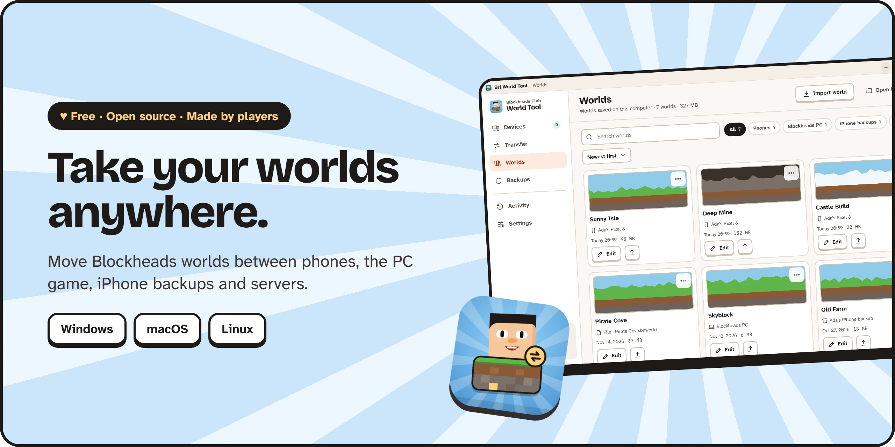
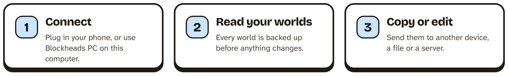
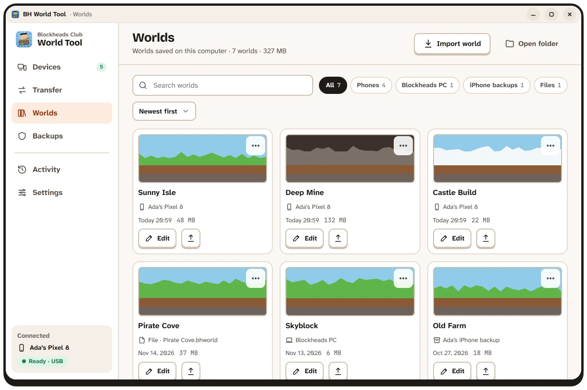
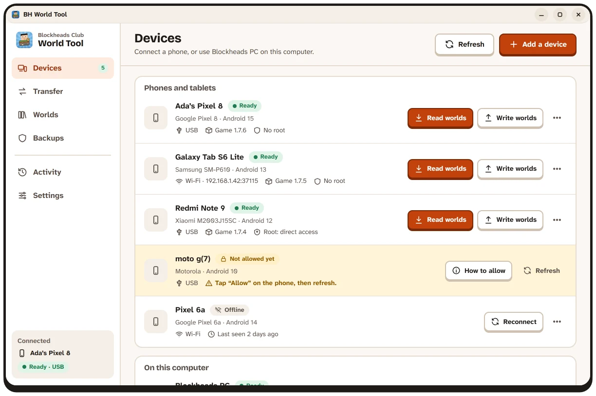
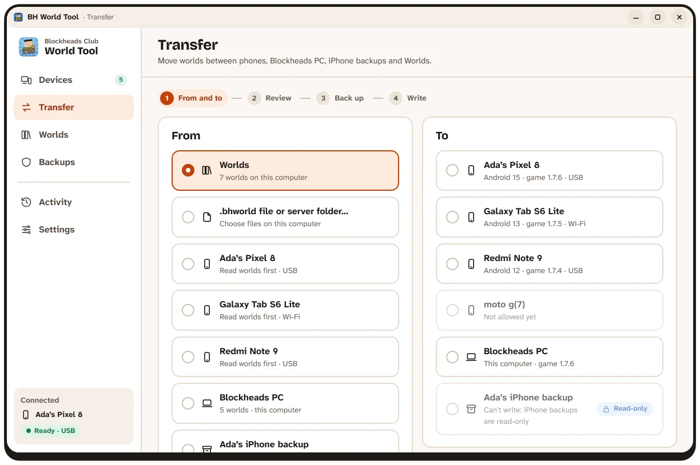

<p align="center">
  <a href="https://github.com/Blockheads-Club/world-tool/releases/latest">
    
  </a>
</p>

<p align="center">
  <a href="https://github.com/Blockheads-Club/world-tool/releases/latest"></a>
  <a href="https://github.com/Blockheads-Club/world-tool/releases"></a>
  <a href="https://github.com/Blockheads-Club/world-tool/stargazers"></a>
  <a href="LICENSE"></a>
</p>

<h3 align="center">
  <a href="https://github.com/Blockheads-Club/world-tool/releases/latest">⬇️ Download</a>
  &nbsp;·&nbsp;
  <a href="https://blockheads.club/docs/guides/backup-worlds">📖 Back up your worlds</a>
  &nbsp;·&nbsp;
  <a href="https://blockheads.club/docs/faq">❓ FAQ</a>
  &nbsp;·&nbsp;
  <a href="https://github.com/Blockheads-Club/world-tool/issues/new">🐞 Report a bug</a>
</h3>

<br>

New phone? Want to play your phone world on your computer, or host it on a server? **BH World Tool** moves your
Blockheads worlds wherever you want them, and backs them up before anything changes. Everything happens on your
computer: your worlds are never uploaded anywhere.

> [!NOTE]
> **Alpha (v0.1.0).** Usable, but keep a backup of your worlds before you write anything back to the game.

## ✨ What you get

<table>
  <tr>
    <td width="50%" valign="top">
      <h3>📱 Phones over USB or Wi-Fi</h3>
      Read and write the worlds on Android phones and tablets. No root needed (rooted phones work too).
    </td>
    <td width="50%" valign="top">
      <h3>💻 Blockheads PC</h3>
      Copy worlds between your phone and <a href="https://github.com/Blockheads-Club/blockheads-pc">Blockheads PC</a>
      on the same computer.
    </td>
  </tr>
  <tr>
    <td valign="top">
      <h3>🍏 iPhone and iPad backups</h3>
      Get your worlds out of an iPhone or iPad backup on your computer.
    </td>
    <td valign="top">
      <h3>🖥️ Servers and files</h3>
      Export worlds as <code>.bhworld</code> files, or move them to and from a
      <a href="https://github.com/Blockheads-Club/blockheads-server">Blockheads Server</a>.
    </td>
  </tr>
  <tr>
    <td valign="top">
      <h3>🛟 Safe by default</h3>
      Every world is backed up before it is replaced, and you can restore it with one click.
    </td>
    <td valign="top">
      <h3>🗺️ World viewer and editor</h3>
      See the whole map, paint with brushes, use schematics, edit players, inventories and world settings.
    </td>
  </tr>
</table>

## 🚀 Move a world in 3 steps

<p align="center"></p>

<p align="center">
  <a href="https://github.com/Blockheads-Club/world-tool/releases/latest"></a>
  <a href="https://github.com/Blockheads-Club/world-tool/releases/latest"></a>
  <a href="https://github.com/Blockheads-Club/world-tool/releases/latest"></a>
</p>

| Your computer | File to download |
| --- | --- |
| 🪟 Windows | `.exe` or `.msi` (x64 and arm64) |
| 🍎 macOS | `.dmg` (Apple Silicon and Intel) |
| 🐧 Linux | `.AppImage`, `.deb` or `.rpm` |

The app updates itself. To use an Android phone, turn on **USB debugging** (or **Wireless debugging**) in the
phone's developer options; the app downloads Google's adb tools the first time if you don't have them. When the phone
asks to back up or restore data, confirm it on the phone.

## 📸 Screenshots

<table>
  <tr>
    <td colspan="2"></td>
  </tr>
  <tr>
    <td width="50%"></td>
    <td width="50%"></td>
  </tr>
</table>

## ❓ Questions

<details>
<summary><b>Do I need to root my phone?</b></summary>
<br>
No. The tool uses Android's own backup and restore over USB debugging. Rooted phones are supported too.
</details>

<details>
<summary><b>Can it write worlds back to an iPhone?</b></summary>
<br>
Not yet. iPhone and iPad backups are read-only: you can copy worlds out of them.
</details>

<details>
<summary><b>What is a <code>.bhworld</code> file?</b></summary>
<br>
One file that holds a whole world, made for sharing and backups. Double-click one to open it in the app. Format:
<a href="docs/bhworld-format.md">docs/bhworld-format.md</a>.
</details>

<details>
<summary><b>Why does the editor ask for the game APK?</b></summary>
<br>
To draw the world with the real block graphics, the editor reads them from <b>your own copy</b> of the game. Without
it, it shows plain colours. No game files are included.
</details>

## 🧱 Part of Blockheads Club

<table>
  <tr>
    <td align="center" width="25%"><a href="https://github.com/Blockheads-Club/blockheads-pc"><br><b>Blockheads PC</b></a><br><sub>Play on your computer</sub></td>
    <td align="center" width="25%"><a href="https://github.com/Blockheads-Club/blockheads-patcher"><br><b>Patcher</b></a><br><sub>Fix the game on your phone</sub></td>
    <td align="center" width="25%"><a href="https://github.com/Blockheads-Club/blockheads-server"><br><b>Server</b></a><br><sub>Host worlds for friends</sub></td>
    <td align="center" width="25%"><a href="https://github.com/Blockheads-Club/mod-sdk"><br><b>Mod SDK</b></a><br><sub>Make your own mods</sub></td>
  </tr>
</table>

<p align="center">All apps, guides and downloads: <a href="https://blockheads.club"><b>blockheads.club</b></a></p>

## 🛠️ For developers

<details>
<summary><b>Build from source</b></summary>
<br>

You need [bun](https://bun.sh) and Rust stable. Java 21 for one cross-check test.

```bash
git clone https://github.com/Blockheads-Club/world-tool.git
cd world-tool/app
bun install
bun tauri dev           # desktop app
bun run test            # UI tests, 100% coverage
cd ..
cargo llvm-cov --workspace --fail-under-lines 100 --fail-under-functions 100   # crate tests, 100% coverage
```

More in [docs/](docs/): save formats ([client-save-format.md](docs/client-save-format.md)), adb download
([adb-download.md](docs/adb-download.md)), iPhone backups ([ios-backup.md](docs/ios-backup.md)), game files
([game-files.md](docs/game-files.md)) and schematics ([schematic-format.md](docs/schematic-format.md)).
</details>

Everyone can open [issues](https://github.com/Blockheads-Club/world-tool/issues) and pull requests. Irrelevant or
abusive issues may be closed or removed.

## 📄 License

BH World Tool is free software under the **GNU GPLv3 or later** (GPL-3.0-or-later): you can redistribute it and/or
modify it under the terms of the GNU General Public License as published by the Free Software Foundation, either
version 3 of the License, or (at your option) any later version. See [LICENSE](LICENSE).
Bundled fonts are under the SIL Open Font License 1.1.

Unofficial fan project, not affiliated with Majic Jungle Games or Noodlecake Studios. Only use it with worlds and game
files you own.
