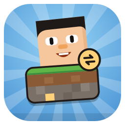

<p align="center">
  
</p>

<h1 align="center">BH World Tool</h1>

<p align="center">
  Copy, back up and edit your <b>The Blockheads</b> worlds on your computer: from your phone, the PC game or a server.
</p>

<p align="center">
  
  <a href="https://github.com/Blockheads-Club/world-tool/releases"></a>
  <a href="https://github.com/Blockheads-Club/world-tool/actions/workflows/ci.yml"></a>
  <a href="LICENSE"></a>
</p>

---

## Project Status
**Current Status:** Alpha (v0.1.0). Usable, but keep a backup of your worlds before you write anything back to the
game.

The World Tool moves The Blockheads worlds between:
- **Android phones**, over USB or Wi-Fi (adb backup and restore; rooted phones are also supported),
- the **Blockheads PC** install on the same computer,
- **iPhone / iPad** backups (read-only),
- **files** on your computer: `.bhworld` exports and [Blockheads Server](https://github.com/Blockheads-Club/blockheads-server) world folders.

It also has a **world viewer and editor**: a map of the whole world, brushes, schematics, players and inventories, and
world settings. The editor draws the graphics from **your own copy** of the game APK.

Everything happens on your computer: **no game files are included**, and your worlds are never uploaded anywhere.

---

## Other Blockheads Club Repositories
- [**blockheads-pc**](https://github.com/Blockheads-Club/blockheads-pc) - Play The Blockheads on your computer
- [**blockheads-patcher**](https://github.com/Blockheads-Club/blockheads-patcher) - Fix crashes and add small improvements to the game on your phone
- [**blockheads-server**](https://github.com/Blockheads-Club/blockheads-server) - Host your own Blockheads server for friends
- [**website**](https://github.com/Blockheads-Club/website) - The [Blockheads Club website](https://blockheads.club/): downloads, guides and docs

---

## Trying BH World Tool
Download it for Windows (`.exe` / `.msi`, x64 and arm64), macOS (`.dmg`, Apple Silicon and Intel) or Linux
(`.AppImage` / `.deb` / `.rpm`) from the [latest release](https://github.com/Blockheads-Club/world-tool/releases/latest).
The app updates itself.

To use an Android phone, turn on **USB debugging** (or **Wireless debugging**) in the phone's developer options. The
app downloads Google's adb tools on first run if they are not installed yet. When the phone asks to back up or restore
data, confirm it on the phone.

Exported worlds are `.bhworld` files ([format](docs/bhworld-format.md)); double-click one to open it in the app.

---

## Requirements
**To use:** Windows, macOS or Linux, and your own copy of The Blockheads. For the editor's graphics, your own game APK.

**For contributors / development:** [bun](https://bun.sh) and Rust stable. Java 21 for one cross-check test.

---

## Contributing
Everyone can open [issues](https://github.com/Blockheads-Club/world-tool/issues) and pull requests. Irrelevant or
abusive issues may be closed or removed.

### Development Guide
```bash
git clone https://github.com/Blockheads-Club/world-tool.git
cd world-tool/app
bun install
bun tauri dev           # desktop app
bun run test            # UI tests, 100% coverage
cd ..
cargo llvm-cov --workspace --fail-under-lines 100 --fail-under-functions 100   # crate tests, 100% coverage
```

More in [docs/](docs/): save formats ([client-save-format.md](docs/client-save-format.md)), adb download
([adb-download.md](docs/adb-download.md)), iPhone backups ([ios-backup.md](docs/ios-backup.md)), game files
([game-files.md](docs/game-files.md)) and schematics ([schematic-format.md](docs/schematic-format.md)).

---

## License
BH World Tool is licensed under **GNU GPLv3 or later** (GPL-3.0-or-later). This program is free software: you can redistribute it and/or modify it under the terms of the GNU General Public License as published by the Free Software Foundation, either version 3 of the License, or (at your option) any later version. See the [LICENSE](LICENSE) file for details.
Bundled fonts are under the SIL Open Font License 1.1.

Unofficial fan project, not affiliated with Majic Jungle Games or Noodlecake Studios. Only use it with worlds and game
files you own.
